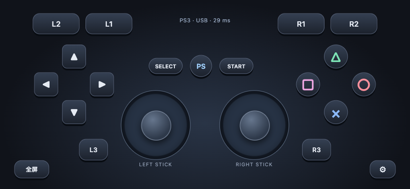

# PS3 Pico W Webpad — Phone to DualShock 3 USB Controller

[简体中文](README.zh-CN.md) · [Download firmware](https://github.com/david-bowiegxw/ps3-picow-webpad/releases) · [Report a bug](https://github.com/david-bowiegxw/ps3-picow-webpad/issues)


**Turn a phone browser and a Raspberry Pi Pico W into a wired PS3 controller.** The phone connects to the Pico W's Wi-Fi access point. The Pico W presents a DualShock 3 style USB device to the PlayStation 3. No phone app, soldering, PSN login, or internet connection is needed for basic controls.



Browser preview with simulated USB status; the displayed RTT is not a hardware benchmark.

```text
Phone touchscreen → local Wi-Fi → Pico W → USB data cable → PS3
```

This is an experimental touchscreen controller and recovery-menu helper, not a Bluetooth controller emulator. It sends inputs; it does not stream the PS3 display to your phone.

## Features

- Landscape controller layout even when browser orientation is locked: portrait view rotates the whole pad, including touch coordinates.
- D-pad on the upper left, △ ○ × □ on the upper right, two analog sticks below and toward the center, shoulder buttons across the top, SELECT / PS / START in the center.
- Independent multi-touch sticks with a touch-relative origin, adjustable travel, and immediate local visual feedback. Separate L3/R3 buttons do not cover the sticks.
- All 17 DS3 digital buttons, including PS and simultaneous START + SELECT.
- Short taps retained until acknowledged; latest-state requests coalesced instead of queuing every move; HTTP keep-alive on the board.
- Button long-press selection/context menus suppressed; release on blur, cancellation, or disconnect. Firmware resets inputs after 400 ms without commands.
- English and Chinese UI; optional browser fullscreen with a CSS rotation fallback.
- Experimental motion-report mapping and simplified vibration feedback, subject to browser restrictions below.

## Tested status — read before flashing

| Item | Evidence / limitation |
| --- | --- |
| v0.1 USB enumeration and recovery controls | User-tested on a CECHL00 PS3, including system recovery |
| v0.2 phone interface | User reported overlaps, portrait layout problems, and awkward sticks; superseded |
| v0.3 layout and touch controls | Automated mobile-size browser tests and host packet tests; firmware cross-compiled |
| v0.3 on-console gameplay and latency | Needs hardware testing; browser request RTT is not end-to-end input latency |
| Sixaxis motion | Experimental 3 acceleration fields + 1 gyro field; axis/calibration fidelity unverified on a PS3 |
| Rumble | Changes in PS3 output produce short phone vibration pulses where supported; not continuous dual-motor reproduction |
| Supported board | Original **Raspberry Pi Pico W (RP2040)**; Pico 2 W / non-W boards / ESP32 builds are not provided |

## Quick start: flash the UF2

1. Download `PS3-PicoW-Webpad-v0.3.0.uf2` from [Releases](https://github.com/david-bowiegxw/ps3-picow-webpad/releases/tag/v0.3.0). The release is marked **pre-release** pending PS3 gameplay validation.
2. Hold **BOOTSEL**, connect the Pico W to your computer using a USB data cable, then release BOOTSEL.
3. Copy the UF2 onto the `RPI-RP2` drive. It disappears when flashing completes.
4. Connect the Pico W's USB port to the PS3. Wait for the Wi-Fi access point to appear (allow roughly 5–10 seconds).
5. Connect the phone to **`PS3-PicoW`**, password **`PicoPad123`**. Stay connected when warned that this network has no internet.
6. Open **`http://192.168.4.1`** in a full browser. The pad appears immediately in a landscape arrangement. Press **PS** to register the controller.
7. Hold the phone sideways. Drag either stick from where your finger lands; release to center. Use the gear menu to adjust stick travel; a smaller value reaches full deflection with less movement.

The public firmware uses a new, documented demonstration Wi-Fi password. If upgrading a private build, forget the old saved network and reconnect. Change `WIFI_PASSWORD` in `src/main.c` before building if you want a private password. Anyone on this access point can send inputs; use one controlling page at a time.

This is controller firmware only. It does not patch the PS3 or install system firmware. Recovery compatibility outside the tested setup is not guaranteed.

## Fullscreen, motion and vibration

- **Landscape:** does not depend on browser fullscreen or orientation-lock support. If the browser stays portrait, the controller is rotated clockwise; turn the phone to match it.
- **Fullscreen:** press the fullscreen button. On iPhone, try Safari → Share → Add to Home Screen if browser fullscreen is unavailable. OS edge gestures may still apply.
- **Motion:** modern browsers generally require a secure context (HTTPS) and sometimes explicit permission. The Pico W serves HTTP, so phone motion will usually be unavailable in this configuration. The UI reports this restriction; ordinary controls still work. The experimental mapper is not a guarantee of native Sixaxis equivalence.
- **Vibration:** opt-in. iPhone Safari does not offer the general Vibration API. Supported Android browsers may produce 80 ms pulses when the reported motor state changes. No browser-independent amplitude control is available.
- **Analog pressure:** touch buttons and L2/R2 are digital 0/255 pressure, not force-sensitive buttons.

References: [MDN motion permissions](https://developer.mozilla.org/en-US/docs/Web/API/DeviceMotionEvent/requestPermission_static), [Vibration API](https://developer.mozilla.org/en-US/docs/Web/API/Vibration_API).

## Build from source

Requirements: Git, CMake, Python 3, an `arm-none-eabi` GCC toolchain, and **Pico SDK 2.2.0**. Local release build uses GCC 14.2.1 on macOS ARM64. No Node.js is needed to build the firmware. See the [official Pico SDK](https://github.com/raspberrypi/pico-sdk/tree/2.2.0) for platform setup.

```sh
git clone https://github.com/david-bowiegxw/ps3-picow-webpad.git
cd ps3-picow-webpad
git clone --depth 1 --branch 2.2.0 https://github.com/raspberrypi/pico-sdk.git pico-sdk
git -C pico-sdk submodule update --init --depth 1 lib/tinyusb lib/lwip lib/cyw43-driver
cmake -S . -B build -DPICO_SDK_PATH="$PWD/pico-sdk" -DCMAKE_BUILD_TYPE=Release
cmake --build build --parallel 4
```

Output: `build/ps3-picow.uf2`. If GCC is not on PATH, add `-DPICO_TOOLCHAIN_PATH=/path/to/arm-toolchain` when configuring. SDK warnings about uninitialized BTstack are expected: this project uses Wi-Fi and USB, not Bluetooth. Only required SDK dependencies are fetched to save disk space.

CMake compresses `src/index.html` into a generated header automatically. A small Python converter produces RP2040 UF2 blocks from the built binary; picotool is not downloaded. Generated files and SDK/toolchain directories are excluded from Git.

## Test and preview

```sh
cc -std=c11 -Wall -Wextra -I src tools/test_packet.c src/packet.c -o /tmp/webpad-packet-test
/tmp/webpad-packet-test
node tools/check.cjs
npm install
npx playwright install chromium
npm test
python3 tools/preview.py
```

Open `http://127.0.0.1:8787` for the simulated controller preview. It does not control a PS3. To reuse an installed browser instead of downloading Chromium, set `CHROME_PATH` to its executable before `npm test`. Browser tests cover six portrait/landscape sizes, overlap and viewport checks, two simultaneous sticks, rotation-correct direction, short taps, release, and one outstanding state request.

See [protocol notes](docs/PROTOCOL.md) and [contribution guide](CONTRIBUTING.md). Please include phone model, browser, screen orientation, board, firmware version, PS3 model and measured request RTT when reporting input problems.

## Troubleshooting

**No Wi-Fi / PS button does nothing:** use a USB data cable, wait for AP startup, check the board type, and inspect `/status`. USB enumeration alone is not proof that every PS3 handshake is complete.

**Joystick feels slow:** reduce travel in settings, move closer to the Pico W, close other controller tabs, and watch request RTT. Screen rendering is local; actual input is still limited by Wi-Fi and PS3/game processing. No latency benchmark is claimed.

**Need a physical controller adapter?** [DualSense-to-DualShock3-Sixaxis](https://github.com/ivveshermosilla/dualsense-to-dualshock3-sixaxis), [RosettaPad](https://github.com/ihasTaco/RosettaPad), and [Bluepad32](https://github.com/ricardoquesada/bluepad32) address related hardware/input scenarios. They are not drop-in versions of this phone webpad.

## License and credits

Project code is [MIT licensed](LICENSE). Adapted DS3 protocol tables retain Ivves Hermosilla's MIT notice; the DHCP server retains Damien P. George's MicroPython notice. Pico SDK, TinyUSB, lwIP and CYW43 components have their own terms. **The combined UF2 is not entirely MIT**: the CYW43 Raspberry Pi license restricts the relevant component to Raspberry Pi silicon. See [third-party notices](THIRD_PARTY_NOTICES.md) and the notices bundled with release downloads.

Independent project; not affiliated with Sony or Raspberry Pi. PlayStation, DualShock and other names identify compatibility, not endorsement.
