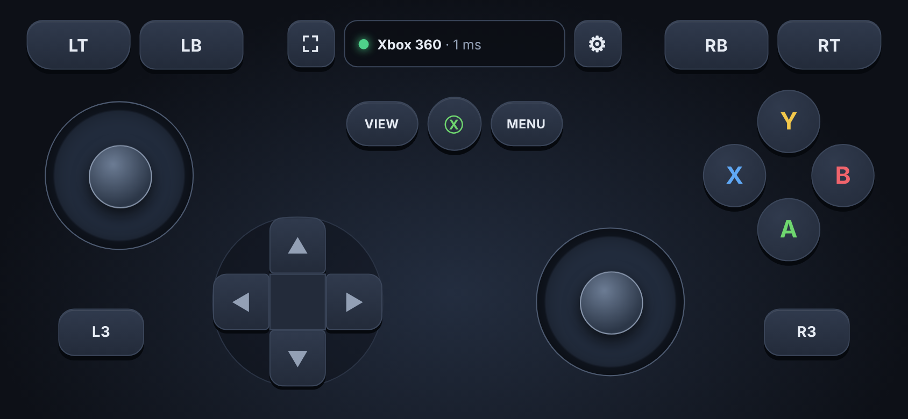
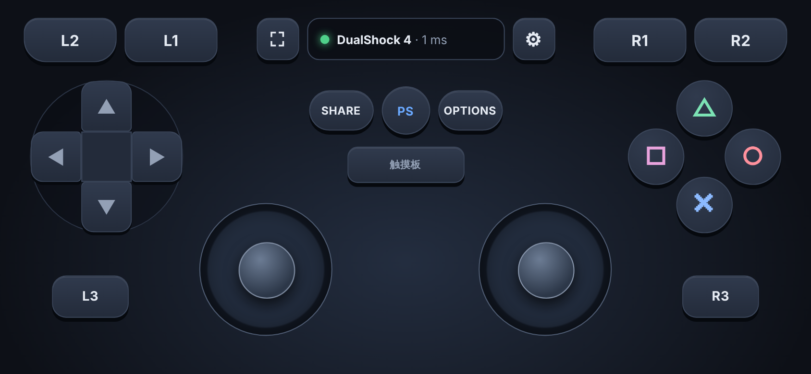
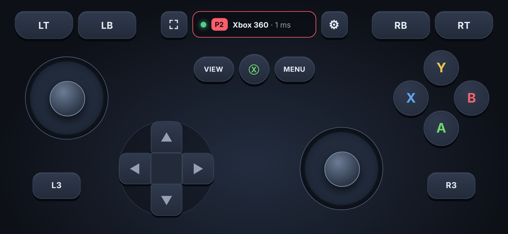
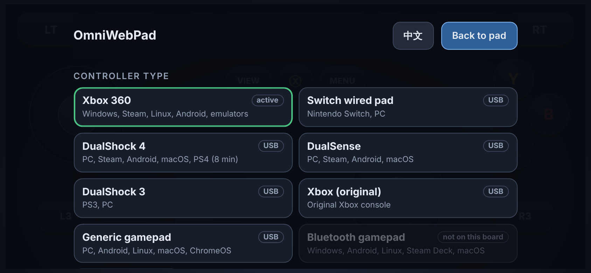

# OmniWebPad — your phone as an Xbox, PlayStation, Switch or Bluetooth controller

[简体中文](README.zh-CN.md) · [Download firmware](https://github.com/david-bowiegxw/omni-webpad/releases) · [Report a bug](https://github.com/david-bowiegxw/omni-webpad/issues)


**A cheap Wi-Fi dev board plugs into a console or PC and pretends to be a controller. Your phone's browser is the touchscreen.** No app, no soldering, no internet, no account. Pick which controller the board impersonates from the settings page — it restarts as that pad in a couple of seconds.



```text
Phone browser ──Wi-Fi──▶ Pico W / ESP32 ──USB or Bluetooth LE──▶ console · PC · phone · tablet
```

Formerly *PS3 Pico W Webpad*. Version 0.4 kept the PS3 controller and added seven more, five more boards and a rebuilt interface; 0.5 lets one board serve up to four players.

## Controllers it can be

| Controller type | Works with | Not for | Feedback shown on the phone |
| --- | --- | --- | --- |
| **Xbox 360** (XInput) | Windows (native), Steam, Linux, Android, most emulators | Xbox 360 / One / Series consoles — they demand a security-chip handshake | Rumble, player LED |
| **Switch wired pad** (HORI Pokkén layout) | Nintendo Switch with *Pro Controller Wired Communication* on, PC | Motion, rumble, NFC | — |
| **DualShock 4** | Windows/Steam, Linux, Android, macOS; PS4 for about 8 minutes at a time | Lasting PS4 use — the console drops unlicensed pads without a signed reply | Rumble, light bar colour |
| **DualSense** | Steam, Linux, Android 12+, macOS | PS5 console (licensed controllers only) | Rumble, player LEDs, light bar colour |
| **DualShock 3** | PlayStation 3, PC | — | Rumble, player LED |
| **Xbox (original)** | Original Xbox through a controller-port-to-USB cable | — | Rumble |
| **Generic gamepad** (HID) | Android, Linux, macOS, ChromeOS, Windows (DirectInput) | — | — |
| **Bluetooth gamepad** (BLE HID) | Windows, Android, Linux, Steam Deck, macOS — no cable | Consoles; iOS/iPadOS (Apple only accepts specific controller models) | — |

Buttons are mapped by position: the bottom face button is always the bottom face button (✕ / A / Switch B). The page relabels and recolours itself for the active controller.

<p>


</p>

## Boards

| Board | Firmware file | USB controllers | Bluetooth gamepad |
| --- | --- | :---: | :---: |
| Raspberry Pi **Pico W** (RP2040) | `omniwebpad-pico_w.uf2` | ✅ | — |
| Raspberry Pi **Pico 2 W** (RP2350) | `omniwebpad-pico2_w.uf2` | ✅ | — |
| **ESP32-S3** | `omniwebpad-esp32s3.bin` | ✅ | ✅ |
| **ESP32-S2** | `omniwebpad-esp32s2.bin` | ✅ | — (no Bluetooth radio) |
| **ESP32-C6** | `omniwebpad-esp32c6.bin` | — | ✅ |
| **ESP32-C3** | `omniwebpad-esp32c3.bin` | — | ✅ |
| **ESP32** (classic WROOM/WROVER) | `omniwebpad-esp32.bin` | — | ✅ |

The C6, C3 and classic ESP32 have no USB device controller — their USB port is a serial/JTAG bridge that cannot enumerate as a gamepad — so they offer the Bluetooth gamepad only. For consoles you need a Pico W, Pico 2 W, ESP32-S2 or ESP32-S3. On an S2/S3 dev board with two connectors, use the one labelled **USB** (native), not **UART**/**COM**.

The **ESP8266** is not supported: it has neither a USB device controller nor Bluetooth, so on its own it has no way to appear as a controller.

## Several players

One board can be up to four controllers, one per phone. Set **Players** in the settings; the board restarts.

 

| Controller type | What the host sees with 2–4 players |
| --- | --- |
| **Xbox 360** | An Xbox 360 Wireless Receiver. Each phone that joins switches on the next controller, and it switches off again when that phone leaves, just like wireless pads |
| **Generic gamepad** | That many separate HID gamepads, present as soon as the board is plugged in |
| PlayStation, Switch, original Xbox, Bluetooth | One pad per board. PS3, PS4 and Switch tell controllers apart by USB device, so use one board per player |

Each phone takes the lowest free player and shows it as a coloured **P1**–**P4** badge; rumble reaches only the phone of the player the game addressed. A phone that reloads or drops off Wi-Fi gets its player back if it returns within four seconds; after that the player is free, and a phone that found every player taken joins automatically. Several boards also work side by side: each has its own Wi-Fi name.

Multi-player mode has passed the same simulated tests as everything else but has not been tried on hardware: in particular, how Windows treats the receiver is unverified (Linux, SteamOS and Android drive it with the standard `xpad` driver). If it misbehaves, the generic gamepad or one board per player are the fallbacks.

## What has actually been tested

This project is honest about the gap between "compiles" and "works on your console".

| Area | Evidence |
| --- | --- |
| Firmware core: every controller's report layout, USB descriptors, feature/control requests, tap latch, settings | Unit tests on every commit (`tests/core_test.c`) |
| Page ↔ firmware: touch, multi-touch, D-pad, sticks, mode switching, Wi-Fi settings, reconnect, several phones as separate players | Chromium driving the real page against the real server core, 8 screen sizes (`tests/ui.test.cjs`) |
| Pico W, Pico 2 W and all five ESP32 targets | Cross-compiled in CI |
| DualShock 3 on a PS3 | The 0.1 firmware was used on a CECHL00 console including system recovery. 0.4 sends the same descriptors and report bytes from restructured code; it has **not** been re-run on a console yet |
| Every other controller type, multi-player mode, every ESP32 board, Pico 2 W | **Not yet run on hardware.** Written from the published protocols and checked by the tests above |
| Motion | Experimental and normally blocked by browsers on plain `http://` pages |

If you try a combination, please [open an issue](https://github.com/david-bowiegxw/omni-webpad/issues) with the result — working reports are as useful as failures. The settings page has a **Diagnostics** button whose output helps a lot.

## Quick start

### 1. Flash

**Pico W / Pico 2 W** — hold **BOOTSEL**, plug the board into a computer, release, and copy the `.uf2` onto the `RPI-RP2` (Pico 2 W: `RP2350`) drive.

**ESP32 family** — each `.bin` is a complete image for offset `0x0`. Hold **BOOT** while plugging in (or while tapping **RESET**) to enter download mode, then either use the browser flasher at <https://espressif.github.io/esptool-js/> or:

```sh
pip install esptool
esptool.py --chip esp32s3 write_flash 0x0 omniwebpad-esp32s3.bin
```

Replace `esp32s3` with your chip. Press **RESET** afterwards.

### 2. Connect

1. Plug the board into the console or PC with a USB **data** cable. (Bluetooth-only boards just need power.)
2. On the phone, join Wi-Fi **`OmniWebPad-XXXX`** with password **`omniwebpad`**. Stay connected when the phone says the network has no internet.
3. Open **`http://192.168.4.1`** and turn the phone sideways.

### 3. Choose the controller

Tap **⚙** → pick a controller type → **Switch and restart**. USB boards start as *Xbox 360*; Bluetooth-only boards start as *Bluetooth gamepad* (pair with **OmniWebPad** in the host's Bluetooth settings). The choice is stored on the board.

> **Upgrading from PS3 Pico W Webpad 0.3?** The Wi-Fi name and password changed, and the board now starts as an Xbox 360 pad. Join the new network, open ⚙ and select **DualShock 3** once to get the PS3 behaviour back.

Change the Wi-Fi name and password in the same page; anyone who can join the access point can send inputs. Forgot the password? Hold **BOOTSEL** (Pico) or **BOOT** (ESP32) for five seconds while the board is running to restore the defaults.

## The touch interface



- **Skins** for Xbox, PlayStation, Switch and generic pads, with the right glyphs, colours and names (LB/RT, ZL/ZR, SHARE/OPTIONS, −/+, Capture, touchpad click).
- **D-pad as one zone:** eight directions, slide between them without lifting.
- **Thumb-roll face buttons:** slide from one to the next, or rest between two to press both.
- **Floating sticks:** wherever your thumb lands is the centre, so there is no jump on touch. Travel is adjustable.
- **Two left-hand layouts:** D-pad on top (PlayStation style) or stick on top (Xbox/Switch style). Automatic by controller type, or forced.
- **Always landscape:** a portrait-locked browser gets a rotated pad with matching touch coordinates. The pad widens on tall phones so the clusters sit under your thumbs.
- **Status pill:** board link, host link, round-trip time, player LEDs and light bar colour. Host rumble vibrates the phone where the browser allows it (Android; iOS Safari has no vibration API). Optional haptic tick on key presses.
- **No lost taps:** every press reaches the host for at least one report even if it was shorter than a frame, and input is released if the page loses focus, a touch is cancelled or the link drops.
- English and Chinese, chosen from the browser language.

Limits of a touchscreen: buttons and triggers are digital (a trigger press is a full pull), there is no touchpad surface, gyro or adaptive trigger emulation, and latency is a few milliseconds of Wi-Fi plus the host's own polling. The displayed round-trip time measures phone ↔ board only.

## How it works

The firmware is one portable C core plus thin platform layers:

```text
web/index.html            the page, gzip-embedded into every firmware
firmware/core/            pad state, HTTP + WebSocket server, settings, input queue
firmware/core/modes/      one file per controller: descriptors + report translation
firmware/usb/             TinyUSB glue shared by Pico and ESP32 (HID + Xbox vendor class)
firmware/platform/pico/   Pico SDK: CYW43 access point, lwIP
firmware/platform/esp32/  ESP-IDF: Wi-Fi access point, sockets, NimBLE HID-over-GATT
firmware/platform/host/   desktop simulator used by the tests
```

The page streams 12-byte binary frames over a WebSocket; the board answers pings with link state and host feedback. The wire format, HTTP API and each controller's report layout are in [docs/PROTOCOL.md](docs/PROTOCOL.md). Adding a controller means adding one file under `firmware/core/modes/` and a line in `mode.c`.

## Develop

No hardware is needed to work on the page or the protocol code:

```sh
npm install
npx playwright install chromium
npm test            # builds the simulator, runs core tests and browser tests
npm run preview     # simulator at http://127.0.0.1:8787
```

Requires CMake, a C compiler and Node 22. Set `CHROME_PATH` to reuse an installed Chromium.

**Pico W / Pico 2 W** (Pico SDK 2.2.0, `arm-none-eabi-gcc`):

```sh
git clone --depth 1 --branch 2.2.0 https://github.com/raspberrypi/pico-sdk.git
git -C pico-sdk submodule update --init --depth 1 lib/tinyusb lib/lwip lib/cyw43-driver lib/mbedtls lib/btstack
cmake -S firmware/platform/pico -B build/pico_w -DPICO_SDK_PATH="$PWD/pico-sdk" -DPICO_BOARD=pico_w
cmake --build build/pico_w          # build/pico_w/omniwebpad-pico_w.uf2
```

Use `-DPICO_BOARD=pico2_w` for the Pico 2 W.

**ESP32 family** (ESP-IDF 5.3 or newer):

```sh
cd firmware/platform/esp32
idf.py set-target esp32s3           # esp32s2 · esp32s3 · esp32c3 · esp32c6 · esp32
idf.py build flash
```

`idf.py menuconfig` → *OmniWebPad* sets the reset-button and status-LED pins for your board.

## Troubleshooting

- **Page will not load:** check the phone is still on the board's Wi-Fi (phones hop back to networks with internet; turn off mobile data or "smart network switch" if needed) and that the address is `http://`, not `https://`.
- **Amber dot, "no host":** the board is reachable but the console or PC has not accepted the controller. Use a data cable, check the controller type suits the host, and look at ⚙ → Diagnostics.
- **Switch does nothing:** enable *System Settings → Controllers and Sensors → Pro Controller Wired Communication*, then press a button.
- **PS3:** press the **PS** button once to assign the controller.
- **Laggy:** move closer to the board, close other tabs using the pad, and keep Bluetooth mode for hosts that cannot use USB — a single radio shared between Wi-Fi and Bluetooth is slower than Wi-Fi plus a cable.
- **Cannot re-flash an ESP32-S2/S3 after installing:** the firmware owns the USB port, so enter download mode by holding **BOOT** while plugging in.

## License and credits

Project code is [MIT licensed](LICENSE). DualShock 3 protocol tables are adapted from Ivves Hermosilla's MIT-licensed work and the Pico DHCP server from MicroPython (Damien P. George); see [THIRD_PARTY_NOTICES.md](THIRD_PARTY_NOTICES.md). SDK components compiled into firmware binaries keep their own licenses, so a binary is not MIT as a whole; in particular the CYW43 firmware in Pico builds is licensed for Raspberry Pi silicon.

Controller behaviour was written from publicly documented protocols; the Linux `xpad` and `hid-playstation` drivers, GP2040-CE and the LUFA Switch-Fightstick project are invaluable references.

Independent project, not affiliated with or endorsed by Microsoft, Sony, Nintendo, HORI, Raspberry Pi or Espressif. Product names and USB identifiers are used only so hosts recognise the device.
