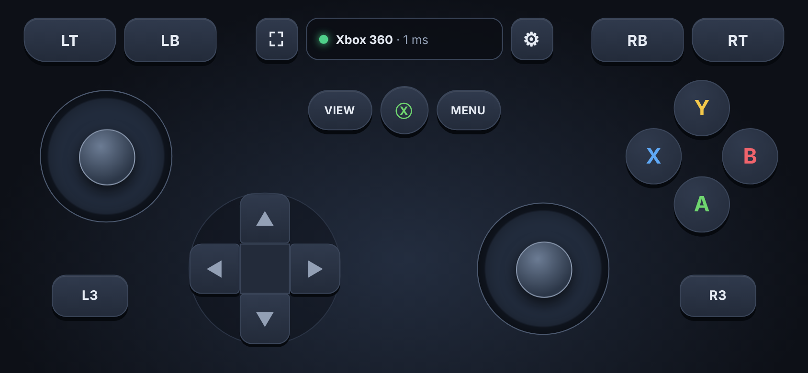
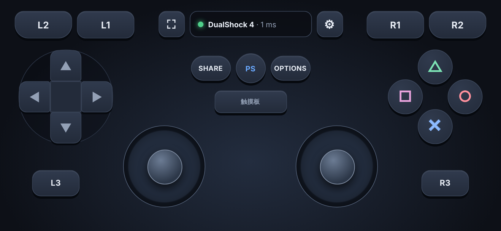
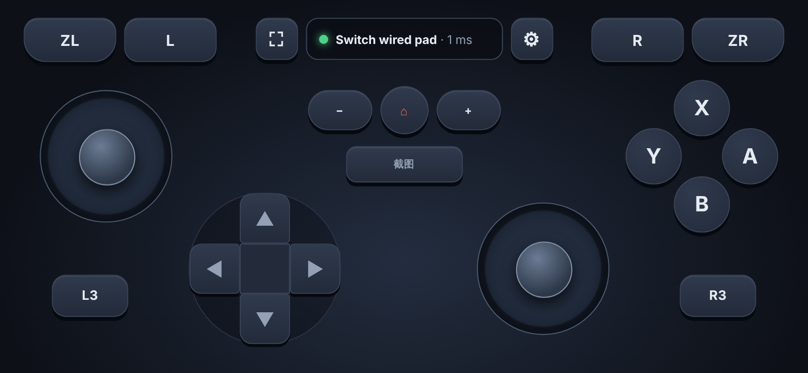
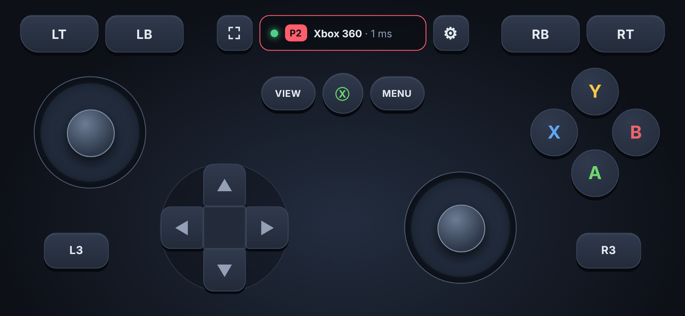
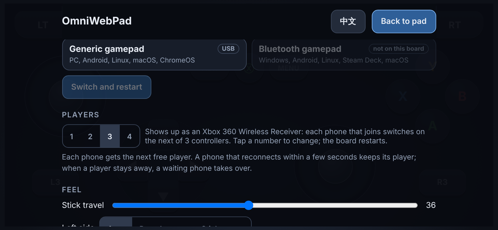
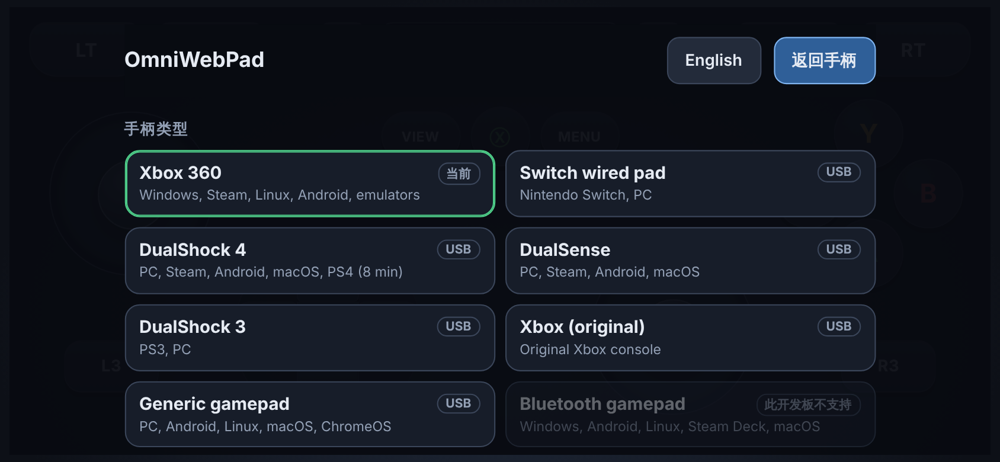

# OmniWebPad：把手机变成 Xbox / PlayStation / Switch / 蓝牙手柄

[English](README.md) · [下载固件](https://github.com/david-bowiegxw/omni-webpad/releases) · [提交测试报告](https://github.com/david-bowiegxw/omni-webpad/issues/new?template=test-report.yml) · [反馈问题](https://github.com/david-bowiegxw/omni-webpad/issues/new?template=bug-report.yml)

> [!IMPORTANT]
> **本项目处于早期开发阶段。** 大部分手柄类型、开发板和多人模式目前只经过模拟测试，仍需实际使用的反馈来验证。欢迎任何形式的反馈：[测试报告](https://github.com/david-bowiegxw/omni-webpad/issues/new?template=test-report.yml)、[问题反馈](https://github.com/david-bowiegxw/omni-webpad/issues/new?template=bug-report.yml)、提问，以及 Pull Request。

**一块几十块钱的 Wi-Fi 开发板插到主机或电脑上冒充手柄，手机浏览器就是触摸屏。** 不用装 App、不用焊接、不用联网、不用登录账号。开发板冒充哪种手柄，在设置页里点一下即可切换，几秒钟后它就以新身份重新被主机识别。



```text
手机浏览器 ──Wi-Fi──▶ Pico W / ESP32 ──USB 或低功耗蓝牙──▶ 主机 · 电脑 · 手机 · 平板
```

本项目原名 *PS3 Pico W Webpad*。0.4 版保留 PS3 手柄，并新增 7 种手柄、5 种开发板和重做的操作界面；0.5 版起一块开发板最多可同时当 4 个手柄用。

## 帮忙测试

这个项目背后没有硬件实验室，作者手上也没有这些主机。除了 PS3 上的 DualShock 3，下面每一种组合都在等第一份实机报告。如果你有 Pico W、Pico 2 W 或 ESP32 开发板，十分钟就够：刷固件、手机连上、玩一局，然后**[提交测试报告](https://github.com/david-bowiegxw/omni-webpad/issues/new?template=test-report.yml)**。表单会提示需要填写的内容，包括网页上的诊断信息。

最需要的测试：

- Windows 上的 **Xbox 360** 模式，1 人和 2–4 人都要（Windows 是否认模拟的无线接收器？）
- Nintendo Switch 上的 **Switch 有线手柄**
- 电脑、Steam 或 Android 上的 **DualShock 4** / **DualSense**，以及 PS4 上的 DualShock 4
- ESP32-C3、C6 或经典 ESP32 的**蓝牙手柄**，连 Android 或 Windows
- 用 0.5 固件在 PS3 上跑 **DualShock 3**
- 任何 **ESP32-S2/S3** 开发板的 USB 模式

## 可以冒充的手柄

| 手柄类型 | 适用 | 不适用 | 手机端可见的反馈 |
| --- | --- | --- | --- |
| **Xbox 360**（XInput） | Windows（原生）、Steam、Linux、Android、绝大多数模拟器 | Xbox 360 / One / Series 主机——它们要求安全芯片握手 | 振动、玩家指示灯 |
| **Switch 有线手柄**（HORI Pokkén 布局） | Nintendo Switch（需开启“Pro 手柄的有线连接”）、PC | 体感、振动、NFC | — |
| **DualShock 4** | Windows/Steam、Linux、Android、macOS；PS4 上每次约 8 分钟 | 在 PS4 上长时间使用——主机会断开无法通过签名认证的非授权手柄 | 振动、灯条颜色 |
| **DualSense** | Steam、Linux、Android 12+、macOS | PS5 主机（只接受授权手柄） | 振动、玩家指示灯、灯条颜色 |
| **DualShock 3** | PlayStation 3、PC | — | 振动、玩家指示灯 |
| **初代 Xbox** | 初代 Xbox（需手柄口转 USB 线） | — | 振动 |
| **通用手柄**（HID） | Android、Linux、macOS、ChromeOS、Windows（DirectInput） | — | — |
| **蓝牙手柄**（BLE HID） | Windows、Android、Linux、Steam Deck、macOS，无需数据线 | 游戏主机；iOS/iPadOS（苹果只接受特定型号的手柄） | — |

按键按**位置**映射：下方的动作键永远是下方那颗（✕ / A / Switch 的 B）。界面会根据当前手柄类型自动更换键名与配色。

<p>


</p>

## 支持的开发板

| 开发板 | 固件文件 | USB 手柄 | 蓝牙手柄 |
| --- | --- | :---: | :---: |
| Raspberry Pi **Pico W**（RP2040） | `omniwebpad-pico_w.uf2` | ✅ | — |
| Raspberry Pi **Pico 2 W**（RP2350） | `omniwebpad-pico2_w.uf2` | ✅ | — |
| **ESP32-S3** | `omniwebpad-esp32s3.bin` | ✅ | ✅ |
| **ESP32-S2** | `omniwebpad-esp32s2.bin` | ✅ | —（没有蓝牙） |
| **ESP32-C6** | `omniwebpad-esp32c6.bin` | — | ✅ |
| **ESP32-C3** | `omniwebpad-esp32c3.bin` | — | ✅ |
| **ESP32**（经典 WROOM/WROVER） | `omniwebpad-esp32.bin` | — | ✅ |

C6、C3 和经典 ESP32 芯片内部没有 USB 设备控制器——板上的 USB 口只是串口/JTAG 桥，无法被识别为手柄——所以它们只提供蓝牙手柄。要接游戏主机，请选 Pico W、Pico 2 W、ESP32-S2 或 ESP32-S3。S2/S3 开发板如果有两个接口，请用标着 **USB**（原生）的那个，而不是 **UART**/**COM**。

**不支持 ESP8266**：它既没有 USB 设备控制器，也没有蓝牙，单靠它本身无法被主机识别为手柄。

## 多人游戏

一块开发板最多可以同时当 4 个手柄，每台手机一个。在设置里选择**玩家人数**，开发板会重启。

 

| 手柄类型 | 2–4 人时主机看到的设备 |
| --- | --- |
| **Xbox 360** | 一个 Xbox 360 无线接收器。每加入一台手机就接通下一个手柄，手机离开时这个手柄也随之断开，和真的无线手柄一样 |
| **通用手柄** | 对应数量的独立 HID 手柄，开发板一插上就全部出现 |
| PlayStation、Switch、初代 Xbox、蓝牙 | 一块开发板一个手柄。PS3、PS4 和 Switch 按 USB 设备区分手柄，请每人用一块开发板 |

每台手机自动占用编号最小的空闲玩家，并在状态栏显示彩色的 **P1**–**P4**；游戏让哪个手柄振动，就只有那位玩家的手机振动。手机刷新页面或 Wi-Fi 掉线后 4 秒内回来，仍是原来的玩家；超过 4 秒这个位置就会空出来，此前因为满员而等待的手机会自动接上。多块开发板也可以同时使用，它们各有自己的 Wi-Fi 名称。

多人模式和其他功能一样通过了模拟测试，但还没有上过真机。尤其是 Windows 对无线接收器的识别还没验证（Linux、SteamOS 和 Android 用自带的 `xpad` 驱动支持它）。如果有问题，可以改用通用手柄，或者每人一块开发板。

## 到底测过什么

“能编译”和“在你的主机上能用”之间有距离，这里如实说明。

| 范围 | 依据 |
| --- | --- |
| 固件核心：每种手柄的报文布局、USB 描述符、特性/控制请求、短按锁存、设置存储 | 每次提交运行单元测试（`tests/core_test.c`） |
| 页面 ↔ 固件：触摸、多指、十字键、摇杆、切换手柄、Wi-Fi 设置、断线重连、多台手机分别当不同玩家 | Chromium 操作真实页面，对接真实的服务核心，覆盖 8 种屏幕尺寸（`tests/ui.test.cjs`） |
| Pico W、Pico 2 W 与 5 种 ESP32 目标 | CI 交叉编译 |
| PS3 上的 DualShock 3 | 0.1 固件曾在 CECHL00 主机上实机使用（含系统恢复）。0.4 的代码结构重写，但发送的描述符与报文字节相同；**尚未重新上机验证** |
| 其余所有手柄类型、多人模式、所有 ESP32 开发板、Pico 2 W | **尚未实机测试。** 依据公开协议编写，并通过上述测试 |
| 体感 | 实验性；普通 `http://` 页面通常被浏览器禁止读取传感器 |

如果你试了某个组合，欢迎[提交测试报告](https://github.com/david-bowiegxw/omni-webpad/issues/new?template=test-report.yml) 告知结果——“能用”的报告和“不能用”的一样有价值。设置页里的**诊断信息**按钮输出的内容对排查很有帮助。

## 快速上手

### 1. 刷写固件

**Pico W / Pico 2 W**：按住 **BOOTSEL** 把开发板插到电脑，松开，把 `.uf2` 拖进 `RPI-RP2`（Pico 2 W 为 `RP2350`）磁盘。

**ESP32 系列**：每个 `.bin` 都是烧到 `0x0` 地址的完整镜像。按住 **BOOT** 再插线（或按住 BOOT 点一下 **RESET**）进入下载模式，然后用浏览器烧录工具 <https://espressif.github.io/esptool-js/>，或者：

```sh
pip install esptool
esptool.py --chip esp32s3 write_flash 0x0 omniwebpad-esp32s3.bin
```

把 `esp32s3` 换成你的芯片型号。烧完按一下 **RESET**。

### 2. 连接

1. 用 USB **数据线**把开发板插到主机或电脑上（仅蓝牙的开发板只需要供电）。
2. 手机连接 Wi-Fi **`OmniWebPad-XXXX`**，密码 **`omniwebpad`**。手机提示“此网络无法上网”时选择保持连接。
3. 浏览器打开 **`http://192.168.4.1`**，把手机横过来。

### 3. 选择手柄类型

点 **⚙** → 选一种手柄 → **切换并重启**。USB 开发板默认是 *Xbox 360*；仅蓝牙的开发板默认是*蓝牙手柄*（在主机的蓝牙设置里配对 **OmniWebPad**）。选择会保存在开发板上。

> **从 PS3 Pico W Webpad 0.3 升级？** Wi-Fi 名称和密码变了，而且开发板默认以 Xbox 360 手柄启动。连上新热点后，打开 ⚙ 选一次 **DualShock 3**，就回到原来的 PS3 用法。

Wi-Fi 名称和密码也在同一页修改；任何连上这个热点的人都能发送输入。忘了密码？开发板运行时按住 **BOOTSEL**（Pico）或 **BOOT**（ESP32）五秒即可恢复默认设置。

## 触屏界面



- **皮肤**：Xbox、PlayStation、Switch 与通用手柄各有对应的符号、配色和键名（LB/RT、ZL/ZR、SHARE/OPTIONS、−/+、截图、触摸板按压）。
- **十字键是一整块触控区**：八个方向，手指不离屏即可滑动换向。
- **动作键可搓招**：从一颗滑到另一颗，或者按在两颗之间同时按下。
- **浮动摇杆**：手指落在哪里，哪里就是中心，不会一碰就跳。行程可调。
- **两种左手布局**：十字键在上（PlayStation 式）或摇杆在上（Xbox/Switch 式），可按手柄类型自动选择，也可以固定。
- **始终横屏**：浏览器锁定竖屏时整个手柄会旋转，触摸坐标同步转换。长屏手机上手柄会加宽，让按键落在拇指下方。
- **状态栏**：开发板连接、主机连接、往返延迟、玩家指示灯、灯条颜色。主机发来的振动会让手机振动（Android 可用；iOS Safari 没有振动接口）。可选的按键触感反馈。
- **短按不丢**：哪怕按下的时间不足一帧，每次按键也至少会出现在一份报文里；页面失焦、触摸被取消或断线时自动松开所有按键。
- 中英文界面，按浏览器语言自动选择。

触摸屏的局限：按键和扳机都是数字量（按下扳机即拉满），没有触摸板表面、陀螺仪和自适应扳机的模拟；延迟由几毫秒的 Wi-Fi 加上主机自身的轮询周期组成。界面显示的往返时间只代表手机 ↔ 开发板这一段。

## 工作原理

固件由一份可移植的 C 核心加上很薄的平台层组成：

```text
web/index.html            操作页面，gzip 后嵌入每个固件
firmware/core/            手柄状态、HTTP + WebSocket 服务、设置、输入队列
firmware/core/modes/      每种手柄一个文件：描述符 + 报文转换
firmware/usb/             Pico 与 ESP32 共用的 TinyUSB 层（HID + Xbox 厂商类）
firmware/platform/pico/   Pico SDK：CYW43 热点、lwIP
firmware/platform/esp32/  ESP-IDF：Wi-Fi 热点、socket、NimBLE HID-over-GATT
firmware/platform/host/   测试用的桌面模拟器
```

页面通过 WebSocket 发送 12 字节的二进制帧；开发板在回应心跳时带上连接状态和主机反馈。传输格式、HTTP 接口和各手柄的报文布局见 [docs/PROTOCOL.md](docs/PROTOCOL.md)。新增一种手柄只需在 `firmware/core/modes/` 下加一个文件，并在 `mode.c` 里登记一行。

## 开发

修改页面或协议代码不需要任何硬件：

```sh
npm install
npx playwright install chromium
npm test            # 编译模拟器，运行核心测试和浏览器测试
npm run preview     # 模拟器：http://127.0.0.1:8787
```

需要 CMake、C 编译器和 Node 22。设置 `CHROME_PATH` 可以复用已安装的 Chromium。

**Pico W / Pico 2 W**（Pico SDK 2.2.0、`arm-none-eabi-gcc`）：

```sh
git clone --depth 1 --branch 2.2.0 https://github.com/raspberrypi/pico-sdk.git
git -C pico-sdk submodule update --init --depth 1 lib/tinyusb lib/lwip lib/cyw43-driver lib/mbedtls lib/btstack
cmake -S firmware/platform/pico -B build/pico_w -DPICO_SDK_PATH="$PWD/pico-sdk" -DPICO_BOARD=pico_w
cmake --build build/pico_w          # build/pico_w/omniwebpad-pico_w.uf2
```

Pico 2 W 使用 `-DPICO_BOARD=pico2_w`。

**ESP32 系列**（ESP-IDF 5.3 及以上）：

```sh
cd firmware/platform/esp32
idf.py set-target esp32s3           # esp32s2 · esp32s3 · esp32c3 · esp32c6 · esp32
idf.py build flash
```

`idf.py menuconfig` → *OmniWebPad* 可以按你的开发板设置复位按键和状态灯引脚。

## 常见问题

- **页面打不开**：确认手机还连着开发板的热点（手机会自动跳回能上网的网络，必要时关掉移动数据或“智能切换网络”），地址是 `http://` 而不是 `https://`。
- **黄点，“未连接主机”**：能连到开发板，但主机或电脑还没有接受这个手柄。换数据线，确认手柄类型适合该主机，再看 ⚙ → 诊断信息。
- **Switch 没反应**：打开“设置 → 手柄与感应器 → Pro 手柄的有线连接”，然后按任意键。
- **PS3**：按一次 **PS** 键分配手柄。
- **有延迟**：离开发板近一点，关掉其他打开着手柄页面的标签页；能用 USB 的主机尽量不用蓝牙模式——Wi-Fi 和蓝牙共用一个射频，比 Wi-Fi 加数据线慢。
- **ESP32-S2/S3 刷过之后无法再次烧录**：固件占用了 USB 口，按住 **BOOT** 再插线即可进入下载模式。

## 许可与致谢

项目代码使用 [MIT 许可](LICENSE)。DualShock 3 协议表改编自 Ivves Hermosilla 的 MIT 项目，Pico 的 DHCP 服务器来自 MicroPython（Damien P. George），详见 [THIRD_PARTY_NOTICES.md](THIRD_PARTY_NOTICES.md)。编译进固件的 SDK 组件保留各自的许可，因此固件二进制整体并非 MIT；其中 Pico 固件内的 CYW43 无线固件仅授权用于 Raspberry Pi 芯片。

各手柄的行为依据公开的协议资料编写；Linux 的 `xpad` 与 `hid-playstation` 驱动、GP2040-CE、LUFA Switch-Fightstick 都是非常宝贵的参考。

本项目为独立项目，与 Microsoft、Sony、Nintendo、HORI、Raspberry Pi、Espressif 均无关联，也未获其认可。产品名称与 USB 标识仅用于让主机识别设备。
